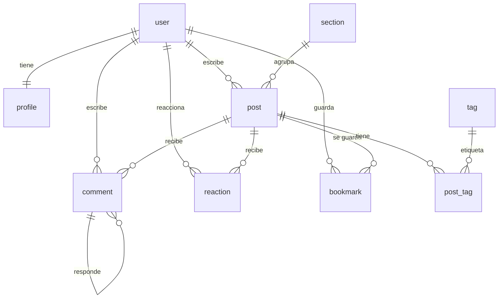

# CodeBug — Plan de proyecto

> **Visión:** una plataforma para que developers publiquen artículos técnicos, compartan hallazgos y discutan sin ruido. Cualquiera puede crear una cuenta, escribir, comentar y reaccionar.

| Campo                | Valor                                                                        |
| -------------------- | ---------------------------------------------------------------------------- |
| Estado               | Planificación                                                                |
| Última actualización | 2026-11-12                                                                   |
| Stack base           | Next.js 16.4 · React 19 · TypeScript · Tailwind 4                            |
| Auth                 | Better Auth 1.7                                                              |
| Base de datos        | Neon Postgres · Prisma ORM                                                   |
| Tooling              | Bun · Biome 2.6 · React Compiler                                             |
| Deploy               | Vercel + Neon                                                                |
| Alcance MVP          | Auth, perfiles, artículos Markdown, feed, secciones, comentarios, reacciones |

---

## Cómo usar este documento

1. Trabaja **una fase a la vez**. No abras la siguiente hasta cumplir el criterio de terminado de la actual.
2. Marca las tareas con `[x]` cuando estén hechas de verdad (funcionando, no solo escritas).
3. Si algo cambia, anótalo en la bitácora y, si es una decisión importante, en `docs/DECISIONS.md`.
4. Usa GitHub Issues/Projects con **un milestone por fase** y etiquetas por área (`area:auth`, `area:posts`, etc.).
5. Cada fase termina con: código funcionando, `biome check` y `typecheck` limpios, estados de carga/error/vacío y una entrada en la bitácora.

**Leyenda de estimaciones:** son días de trabajo enfocado. A tiempo parcial (2–3 h/día) multiplica por 3–4.

---

## 1. Visión y alcance

### Qué es CodeBug

Un sitio tipo daily.dev pero con contenido propio de la comunidad:

- Cualquiera se registra y crea su perfil.
- Publica artículos en Markdown con portada, sección y tags.
- El resto puede leer, comentar, reaccionar y guardar.
- Hay secciones (Frontend, Backend, DevOps, IA, etc.) y un feed con lo más reciente y lo más popular.

### MVP (lo que sí entra)

- Registro/login con email y contraseña + GitHub OAuth.
- Verificación de email y recuperación de contraseña.
- Perfil público editable (username, bio, avatar, sitio web).
- Crear, editar, guardar borrador y publicar artículos en Markdown.
- Portada, extracto, sección, tags, tiempo de lectura y slug.
- Feed principal, páginas de sección y de tag.
- Página de artículo con resaltado de código, metadatos y Open Graph.
- Comentarios con respuestas (un nivel o árbol simple).
- Reacciones (like/fire/insightful) y bookmarks.
- Búsqueda básica con Postgres full-text.
- Moderación mínima: borrar contenido propio, roles `user`/`moderator`/`admin`.
- Rate limiting, analítica, error tracking y páginas legales.

### Explícitamente fuera del MVP (backlog)

- Follows y feed personalizado.
- Notificaciones in-app y por email.
- Mensajería/chat y comentarios en tiempo real.
- Recomendaciones, newsletter, digest.
- Dashboard de moderación avanzado, reportes y bans.
- Gamificación, badges, series/colecciones.
- i18n, PWA, API pública, app móvil.
- Editor rich text (Tiptap). Primero Markdown.

> **Regla de oro:** si una feature no ayuda a “alguien publica un artículo y otra persona lo lee/comenta/reacciona”, no entra al MVP.

---

## 2. Principios de ejecución

1. **Vertical slices, no capas sueltas.** Cada fase debe dejar algo usable de punta a punta. Evita “primero hago todo el backend y después todo el frontend”.
2. **Deploy temprano.** Publica un preview en Vercel después de la fase 2 y vuelve a desplegar al final de cada fase. Integrar tarde es más caro.
3. **Server-first.** En App Router, las lecturas van en Server Components y las mutaciones en Server Actions. TanStack Query solo donde aporta de verdad (interacción, caché de cliente, optimistic UI).
4. **Seguridad desde el día 1.** Es una app pública: toda entrada se valida, toda acción se autoriza en el servidor, todo contenido de usuario se sanitiza.
5. **Aprender > acumular features.** Es mejor un MVP pequeño, terminado y desplegado que 20 features a medias.
6. **Una sola fuente de verdad por dato.** No dupliques el estado del servidor en `useState` sin motivo. Si TanStack Query lo maneja, no lo copies a otro store.
7. **Optimiza después de medir.** Nada de Redis, colas o microservicios hasta que el problema exista.

---

## 3. Stack decidido

### Núcleo

| Capa             | Elección                                                      | Por qué                                                                                        | Alternativa que descartamos              |
| ---------------- | ------------------------------------------------------------- | ---------------------------------------------------------------------------------------------- | ---------------------------------------- |
| Framework        | Next.js 16.4 App Router + React 19                            | Ya está en el repo. RSC, Server Actions, caching y SEO integrados                              | Pages Router                             |
| Lenguaje         | TypeScript `strict`                                           | Seguridad y refactor sin miedo                                                                 | JS                                       |
| Estilos          | Tailwind CSS 4 + shadcn/ui + lucide-react                     | Tailwind ya está configurado con Turbopack. shadcn da componentes accesibles que puedes editar | MUI, Chakra                              |
| Base de datos    | Neon Postgres                                                 | Serverless, free tier, branching, buen fit con Vercel                                          | Supabase, SQLite, MySQL                  |
| ORM              | Drizzle ORM + drizzle-kit                                     | SQL-like, tipado, migraciones versionadas, excelente con Neon                                  | Prisma (más pesado, pero más “mágico”)   |
| Auth             | Better Auth + Drizzle adapter                                 | Email/password, OAuth, sesiones, plugins, compatible con Next 16                               | Clerk, NextAuth/Auth.js, Supabase Auth   |
| Validación       | Zod 4                                                         | Esquemas reutilizables en formularios, Server Actions y APIs                                   | Valibot, Yup                             |
| Formularios      | React Hook Form + `@hookform/resolvers`                       | Buen DX para formularios complejos; `useActionState` para los simples                          | Formik                                   |
| Datos en cliente | TanStack Query 5 (selectivo)                                  | Infinite feed, optimistic updates, devtools                                                    | SWR, Zustand para todo                   |
| Editor           | Markdown + preview                                            | Simple, seguro, enseña renderizado y sanitización                                              | Tiptap desde el inicio                   |
| Markdown         | `react-markdown` + `remark-gfm` + `rehype-sanitize` + `shiki` | GFM, tablas, código resaltado y sanitización                                                   | MDX (peligroso con contenido de usuario) |

### Servicios

| Necesidad     | Elección                              | Nota                                                      |
| ------------- | ------------------------------------- | --------------------------------------------------------- |
| Imágenes      | UploadThing (o Vercel Blob)           | Empieza con UploadThing por su integración con Next       |
| Emails        | Resend + React Email                  | Verificación y reset; en dev puedes loguear el link       |
| Rate limiting | Upstash Redis + `@upstash/ratelimit`  | Necesario para auth, comentarios y reportes               |
| Analítica     | Vercel Analytics + Speed Insights     | Actívalo al desplegar                                     |
| Errores       | Sentry (`@sentry/nextjs`)             | Fase 9; no lo instales antes de tener algo que monitorear |
| Tests         | Vitest + Testing Library + Playwright | Unitarias para lógica, E2E para flujos críticos           |

### Tooling

- **Bun** (`bun@1.4.2`) como package manager y runner.
- **Biome 2.6** (ya configurado): lint + format + organización de imports en una sola herramienta. Config actual: tabs, comillas simples, ancho 80, `organizeImports` activo.
- **TypeScript** en modo `strict`, con script `typecheck` (`tsc --noEmit`).
- **React Compiler** activo (`reactCompiler: true`): memoización automática; no escribas `useMemo`/`useCallback` preventivos.
- **Husky + lint-staged** para que no entre código sin formatear (ejecuta `biome check --write` en staged).
- **commitlint** con Conventional Commits (opcional pero recomendado).
- **Drizzle Studio** para inspeccionar la base de datos sin escribir SQL.

### Versiones estables verificadas (nov 2026)

```txt
next 16.4.6            react 19.3.0           tailwindcss 4.3.3
better-auth 1.7.22     drizzle-orm 0.45.4     drizzle-kit 0.31.11
@tanstack/react-query 5.107.1                 zod 4.6.7
react-hook-form 7.92.0 shadcn 4.23.0          lucide-react 1.72.0
react-markdown 10.1.0  shiki 4.6.0            @upstash/ratelimit 2.2.1
resend 6.38.0          uploadthing 7.7.4      vitest 5.1.0
@playwright/test 1.65.0 @biomejs/biome 2.6.7  babel-plugin-react-compiler 1.0.0
```

> **Drizzle:** usa la línea estable `0.45.x`. La v1 está en beta; no migres hasta que sea estable.

---

## 4. Particularidades de Next.js 16 en este repo

Este proyecto **no** es el Next.js de tutoriales viejos. Antes de escribir código, consulta la documentación local en `node_modules/next/dist/docs/`. Puntos que afectan el plan:

- **`proxy.ts`, no `middleware.ts`.** Next 16 renombró Middleware a Proxy. Se usa solo para redirecciones optimistas (existencia de cookie), **nunca** como única validación de sesión.
- **`params` y `searchParams` son Promises.** En páginas y layouts se resuelven con `await` o `.then()`.
- **`cacheComponents: true` y `partialPrefetching: true` ya están activos** en `next.config.ts`. Esto cambia el modelo de caché y prerender.
- **`reactCompiler: true` ya está activo.** El compilador memoiza automáticamente. Escribe componentes puros y respeta las reglas de React; no agregues `useMemo`/`useCallback` “por si acaso”. Si un componente falla, revisa las reglas antes de desactivar el compilador.
- **Leer la sesión produce datos de request.** Con Cache Components, un componente que lee `cookies()`/`headers()` debe estar dentro de `<Suspense>` o usar `use cache: private`. No pongas el `await` de la sesión en el tope de un layout.
- **Caché explícita:** usa `use cache` + `cacheLife()` + `cacheTag()` para datos públicos (feed, artículo, sección). Tras una mutación, invalida con `updateTag()` (lectura inmediata en Server Actions) o `revalidateTag()` (stale-while-revalidate). Lee `01-getting-started/09-revalidating.md`.
- **Route Handlers** corren en request time por defecto; pueden prerenderizarse si no acceden a datos de request. Para endpoints de feed/búsqueda, sé explícito con el comportamiento que quieres.
- **No hagas `fetch()` a tus propias Route Handlers desde Server Components.** Llama directamente a la función de datos (DAL) y evita un salto HTTP interno.
- **TanStack Query con Cache Components** tiene un patrón específico: `HydrationBoundary`, `dehydrate` y, si prerenderizas, un helper de hidratación con `use cache`. Lee `02-guides/client-side-data-fetching/tanstack-query.md` antes de la fase 5.

Documentos locales prioritarios:

```txt
node_modules/next/dist/docs/01-app/01-getting-started/05-server-and-client-components.md
node_modules/next/dist/docs/01-app/01-getting-started/06-fetching-data.md
node_modules/next/dist/docs/01-app/01-getting-started/07-mutating-data.md
node_modules/next/dist/docs/01-app/01-getting-started/08-caching.md
node_modules/next/dist/docs/01-app/01-getting-started/09-revalidating.md
node_modules/next/dist/docs/01-app/01-getting-started/15-route-handlers.md
node_modules/next/dist/docs/01-app/01-getting-started/16-proxy.md
node_modules/next/dist/docs/01-app/02-guides/authentication-with-cache-components.md
node_modules/next/dist/docs/01-app/02-guides/client-side-data-fetching/tanstack-query.md
node_modules/next/dist/docs/01-app/02-guides/data-security.md
```

---

## 5. Arquitectura de carpetas

Propuesta: route groups para separar marketing, auth y app; lógica de dominio en `lib` y `features`; componentes de UI reutilizables en `components`.

```txt
app/
  (marketing)/
    page.tsx                 # landing pública
    about/page.tsx
    terms/page.tsx
    privacy/page.tsx
  (auth)/
    sign-in/page.tsx
    sign-up/page.tsx
    forgot-password/page.tsx
    reset-password/page.tsx
    verify-email/page.tsx
  (main)/
    layout.tsx               # shell con header/sidebar
    feed/page.tsx
    sections/[slug]/page.tsx
    tags/[slug]/page.tsx
    posts/[slug]/page.tsx
    search/page.tsx
    bookmarks/page.tsx
    u/[username]/page.tsx
  (dashboard)/
    layout.tsx               # shell del autor
    dashboard/page.tsx
    dashboard/posts/new/page.tsx
    dashboard/posts/[id]/edit/page.tsx
    settings/profile/page.tsx
  api/
    auth/[...all]/route.ts   # Better Auth
    uploadthing/route.ts     # si usas UploadThing
  layout.tsx
  not-found.tsx
  error.tsx
  global-error.tsx

components/
  ui/                        # shadcn (button, input, dialog...)
  layout/                    # header, sidebar, mobile-nav, user-menu
  posts/                     # post-card, post-meta, post-content
  comments/
  shared/                    # avatar, empty-state, skeletons, tag-pill

features/
  posts/
    actions.ts               # Server Actions
    queries.ts               # DAL: getPostBySlug, listFeed...
    schema.ts                # Zod
    types.ts
  comments/
  reactions/
  profiles/

lib/
  db/
    index.ts                 # cliente Drizzle
    schema.ts                # todas las tablas
    seed.ts
  auth/
    auth.ts                  # instancia Better Auth (server)
    auth-client.ts           # cliente React
    session.ts               # getSession, requireUser, getCurrentUser
  validations/
  utils.ts                   # cn, slugify, reading-time
  env.ts                     # validación de variables de entorno

docs/
  PLAN.md
  DECISIONS.md
```

**Reglas:**

- `lib/db`, `lib/auth/auth.ts` y las queries llevan `import 'server-only'` cuando corresponda.
- Nada de importar el cliente de base de datos en Client Components.
- Los componentes de `components/ui` se pueden tocar; son tuyos, no una dependencia.
- Coloca los archivos privados de una ruta en `_components`/`_lib` si no quieres crear una carpeta de feature.
- Biome formatea con **tabs y comillas simples**. No pelees con el formato: deja que `bun run check` lo arregle.

---

## 6. Modelo de datos

### Diagrama



### Tablas

**Auth (las genera Better Auth; no las inventes a mano):**

- `user`: `id`, `name`, `email` (único), `emailVerified`, `image`, `createdAt`, `updatedAt`.
- `session`: sesiones activas.
- `account`: credenciales y providers OAuth.
- `verification`: tokens de verificación/reset.

**Dominio:**

- `profiles`
  - `userId` PK/FK → `user.id` (1:1), `username` único (para `/u/[username]`), `bio`, `website`, `role` (`user` | `moderator` | `admin`), `createdAt`, `updatedAt`.
- `sections`
  - `id`, `name`, `slug` único, `description`, `color`, `icon`, `sortOrder`.
- `tags`
  - `id`, `name`, `slug` único.
- `posts`
  - `id`, `authorId` → `user.id`, `sectionId` → `sections.id`, `title`, `slug` único, `excerpt`, `content` (Markdown), `coverImageUrl`, `status` (`draft` | `published` | `archived`), `publishedAt`, `readingTimeMinutes`, `viewCount`, `createdAt`, `updatedAt`.
- `post_tags`
  - PK compuesta (`postId`, `tagId`).
- `comments`
  - `id`, `postId`, `authorId`, `parentId` (self FK, nullable), `content` (Markdown), `createdAt`, `updatedAt`, `deletedAt` (soft delete).
- `reactions`
  - `id`, `userId`, `postId` (nullable), `commentId` (nullable), `type` (`like` | `fire` | `insightful` | `funny`), `createdAt`.
  - Constraint: exactamente uno de `postId`/`commentId`; único por (`userId`, target, `type`).
- `bookmarks`
  - PK (`userId`, `postId`), `createdAt`.

**Post-MVP:** `follows`, `notifications`, `reports`, `audit_logs`, `post_views`.

### Índices y constraints importantes

- `posts.slug`, `profiles.username`, `sections.slug`, `tags.slug` únicos.
- `posts (status, published_at DESC)` para el feed.
- `posts (section_id, published_at DESC)` para secciones.
- `comments (post_id, created_at)`, `comments (parent_id)`.
- `reactions (post_id)`, `reactions (comment_id)`.
- Full-text: columna generada `search_vector` sobre `title`, `excerpt` y `content`, con índice GIN. En Drizzle se hace con `generatedAlwaysAs` + `sql`.
- Soft delete en comentarios para no romper hilos.
- `viewCount` se incrementa con throttling (no en cada request de bot). Para el MVP puede ser un `UPDATE` simple; en fase 9 se mejora.

---

## 7. Estrategia de datos: qué usar para cada cosa

| Necesidad                       | Herramienta                                         | Motivo                                           |
| ------------------------------- | --------------------------------------------------- | ------------------------------------------------ |
| Feed, artículo, sección, perfil | Server Component + DAL + `use cache`                | SEO, primera pintura rápida, menos JS            |
| Crear/editar/publicar artículo  | Server Action + `useActionState`                    | Mutación segura en servidor, revalidación simple |
| Comentario o reacción simple    | Server Action + `useOptimistic`                     | Feedback inmediato sin otra capa                 |
| Infinite scroll del feed        | TanStack Query (`useInfiniteQuery`) + Route Handler | Caché de cliente, paginación acumulativa         |
| Reacciones con optimistic UI    | TanStack Query `useMutation`                        | Rollback fácil si falla                          |
| Búsqueda con autocompletado     | TanStack Query (`enabled`, debounce)                | Cancelación y caché por query                    |
| Notificaciones (post-MVP)       | TanStack Query con polling                          | Se puede migrar a realtime después               |

**Contrato compartido:** si una misma query se usa en servidor y cliente, define `queryKey` y `queryFn` en un módulo sin imports de servidor (ej. `features/posts/post-cache.ts`) y reutilízalo en ambos lados. Evita strings de query key duplicados.

**Regla:** no conviertas toda la app en client-side. Si una página puede renderizarse en el servidor, hazlo ahí.

---

## 8. Seguridad y moderación (app pública)

Una cuenta pública implica responsabilidad. Checklist base:

- [ ] Validar **todas** las entradas con Zod en el borde (Server Actions, Route Handlers, formularios).
- [ ] Autorizar **en el servidor** en cada acción: sesión válida + ownership + rol. No confíes en que la UI oculta el botón.
- [ ] Centralizar lecturas/escrituras en una Data Access Layer (`features/*/queries.ts` y `actions.ts`).
- [ ] `import 'server-only'` en todo módulo con secretos o acceso a DB.
- [ ] Sanitizar Markdown con `rehype-sanitize` y no usar `dangerouslySetInnerHTML` con HTML del usuario.
- [ ] Verificar email antes de publicar o comentar (o limitar acciones hasta verificarlo).
- [ ] Rate limit en auth, comentarios, reacciones y reportes (Upstash).
- [ ] Cookies `httpOnly`, `secure`, `sameSite` (Better Auth lo maneja; no las manipules a mano).
- [ ] Validar tipo/tamaño de imágenes subidas; servir desde un dominio permitido.
- [ ] Headers de seguridad: CSP, HSTS, `X-Content-Type-Options`, `Referrer-Policy`. Next 16 tiene guía de CSP en `02-guides/content-security-policy.md`.
- [ ] No exponer emails ni datos privados en perfiles públicos.
- [ ] Páginas legales (términos, privacidad) y aviso de moderación.
- [ ] Backups de Neon y plan de restauración.
- [ ] Soft delete + auditoría básica para moderación (post-MVP: panel completo).

Roles:

- `user`: crea/edita/borra su contenido, comenta, reacciona.
- `moderator`: además puede ocultar/borrar contenido ajeno y suspender cuentas.
- `admin`: todo + gestión de roles y secciones.

---

## 9. Roadmap por fases

### Fase 0 — Fundaciones y tooling (1–2 días)

**Objetivo:** repo listo para construir sin fricción.

- [ ] Leer los documentos de Next 16 listados en la sección 4.
- [ ] Crear `.env.example` con todas las variables y validarlas en `lib/env.ts` con Zod. Añadir `!.env.example` al `.gitignore` (hoy `.env*` lo ignora).
- [ ] Revisar `biome.json`: tabs, comillas simples, ancho 80 e imports organizados. Opcional: activar `nursery/useSortedClasses` para ordenar clases de Tailwind.
- [ ] Añadir scripts `typecheck` (`tsc --noEmit`), `db:generate`, `db:migrate`, `db:push`, `db:studio`, `db:seed`.
- [ ] Configurar CI básica (GitHub Actions): `bun install --frozen-lockfile`, `bun run lint`, `bun run typecheck`.
- [ ] Crear la estructura de carpetas y route groups de la sección 5.
- [ ] Inicializar shadcn/ui (`bunx shadcn@latest init`) y añadir los primeros componentes: button, input, textarea, dialog, dropdown-menu, avatar, badge, tabs, skeleton, sonner.
- [ ] Definir tokens de diseño en `app/globals.css` (colores, radios, tipografía) y modo oscuro con `next-themes`.
- [ ] Shell base: header, footer, contenedor, tipografía y metadata del sitio.
- [ ] `not-found.tsx`, `error.tsx`, `global-error.tsx`, `loading.tsx` base.
- [ ] README con descripción, stack, comandos y link a este plan.

**Practicas:** Tailwind 4 CSS-first, route groups, Server/Client Components, metadata, Biome, React Compiler.

**Terminado cuando:** `bun dev` muestra un shell con tema claro/oscuro, `bun run lint`, `bun run typecheck` y `bun run build` pasan, y el README explica cómo levantar el proyecto.

---

### Fase 1 — Base de datos y esquema (1–2 días)

**Objetivo:** Postgres real, migraciones reproducibles y datos de ejemplo.

- [ ] Crear proyecto en Neon; separar ramas `main` y `dev` si es posible.
- [ ] Configurar `DATABASE_URL` (pooled) y `DIRECT_URL` (unpooled para migraciones).
- [ ] Crear `lib/db/index.ts` con `prisma-orm/neon-http` y el schema.
- [ ] Crear `prisma.config.ts` apuntando a `DIRECT_URL`.
- [ ] Generar las tablas de Better Auth con su CLI (`bunx auth@latest generate` o el comando vigente en la doc) y revisar el SQL generado.
- [ ] Añadir las tablas de dominio de la sección 6.
- [ ] Generar y aplicar la primera migración; verificar con Prisma Studio.
- [ ] Seed idempotente: secciones, tags y 2–3 posts de ejemplo.
- [ ] Documentar el flujo: cambiar schema → `db:generate` → revisar SQL → `db:migrate`.

**Practicas:** Prisma schema, relaciones, enums, índices, migraciones, seeds, Neon.

**Terminado cuando:** puedes borrar la base, correr `bun db:migrate && bun db:seed` y tener el mismo estado.

---

### Fase 2 — Autenticación y perfiles (2–3 días)

**Objetivo:** cualquiera puede registrarse, verificar su email, entrar y completar su perfil.

- [ ] Configurar `lib/auth/auth.ts`: `betterAuth`, `drizzleAdapter`, `emailAndPassword`, `socialProviders` (GitHub), `nextCookies()` al final.
- [ ] Montar `app/api/auth/[...all]/route.ts` con `toNextJsHandler`.
- [ ] Crear `lib/auth/auth-client.ts` con `createAuthClient`.
- [ ] Páginas y formularios: sign-up, sign-in, forgot-password, reset-password, verify-email.
- [ ] Verificación de email y reset con Resend (en dev, loguear el link).
- [ ] Helper de sesión: `getSession`, `requireUser`, `getCurrentUser` (con `server-only` y compatible con Cache Components).
- [ ] Onboarding: crear `profile` con username único, bio y avatar.
- [ ] `proxy.ts` solo para redirección optimista si no hay cookie; la validación real va en páginas/acciones.
- [ ] User menu en el header dentro de `<Suspense>` (lee sesión).
- [ ] Primer deploy a Vercel con env de producción y smoke test de auth.

**Practicas:** Better Auth, OAuth, sesiones, cookies, Server Actions, formularios, autorización, Suspense con Cache Components.

**Terminado cuando:** un usuario nuevo se registra, verifica, inicia sesión, completa su perfil, cierra sesión y no puede acceder a rutas privadas sin sesión.

---

### Fase 3 — Diseño, navegación y componentes (2–3 días)

**Objetivo:** que la app se sienta como un producto, no como un CRUD.

- [ ] Shell principal: sidebar de secciones, topbar con búsqueda, botón “Escribir”, menú de usuario y navegación móvil.
- [ ] Layout de feed: columna principal + barra lateral (secciones, tags populares, CTA).
- [ ] Componentes: `PostCard`, `PostMeta`, `AuthorBadge`, `TagPill`, `SectionBadge`, `EmptyState`, skeletons.
- [ ] Estados de carga con Suspense y skeletons; estados vacíos y de error.
- [ ] Responsive real: móvil, tablet, desktop.
- [ ] Accesibilidad: foco visible, labels, contraste, navegación por teclado.
- [ ] Página de landing en `(marketing)` con propuesta de valor.

**Practicas:** composición de componentes, Tailwind, diseño responsive, accesibilidad, Suspense/loading.

**Terminado cuando:** se puede navegar toda la estructura con datos mock, en móvil y desktop, sin errores de consola.

---

### Fase 4 — Artículos y editor Markdown (4–6 días)

**Objetivo:** el corazón del producto: escribir y publicar.

- [ ] Implementar el DAL y las Server Actions de posts (`create`, `update`, `publish`, `unpublish`, `delete`).
- [ ] Editor en `/dashboard/posts/new` y `/dashboard/posts/[id]/edit`:
  - [ ] Título, extracto, sección, tags, portada.
  - [ ] Markdown con tabs “Escribir” / “Vista previa”.
  - [ ] Preview sanitizado con GFM, tablas y bloques de código con Shiki.
  - [ ] Generación de slug único y edición manual con validación.
  - [ ] Guardado de borrador y autosave local (localStorage) para no perder texto.
- [ ] Subida de portada (UploadThing o Vercel Blob) con validación de tipo/tamaño.
- [ ] Cálculo de tiempo de lectura.
- [ ] Publicación: `status`, `publishedAt`, revalidación del feed.
- [ ] Página pública `/posts/[slug]`:
  - [ ] Render de Markdown sanitizado.
  - [ ] Metadatos (`generateMetadata`), Open Graph e imagen OG.
  - [ ] Autor, sección, tags, fecha y tiempo de lectura.
  - [ ] Contenido draft solo visible para el autor.
- [ ] Autorización: solo autor/admin edita o borra; verificar en servidor.
- [ ] Dashboard del autor: lista de borradores y publicados.

**Practicas:** Server Actions, formularios, validación Zod, uploads, Markdown seguro, SEO, autorización, revalidación.

**Terminado cuando:** un usuario escribe un artículo, lo previsualiza, lo publica, lo ve en `/posts/[slug]` y otro usuario puede leerlo; un draft no es accesible públicamente.

---

### Fase 5 — Feed, secciones, tags y búsqueda (3–4 días)

**Objetivo:** descubrir contenido.

- [ ] Feed principal con posts publicados, ordenado por fecha.
- [ ] Paginación server-side y luego “cargar más”/infinite con TanStack Query si aporta.
- [ ] Página de sección `/sections/[slug]`.
- [ ] Página de tag `/tags/[slug]`.
- [ ] Orden “Recientes” / “Populares” (por reacciones o views).
- [ ] Búsqueda full-text en Postgres sobre título, extracto y contenido.
- [ ] Filtros combinables (sección + tag + query) con `searchParams`.
- [ ] Caché: `use cache` + `cacheLife` + `cacheTag` en feed y páginas públicas; invalidar al publicar/editar.
- [ ] Página `/search` con estado vacío y debounce.

**Practicas:** Cache Components, revalidación, paginación, full-text search, `searchParams` asíncronos, TanStack Query.

**Terminado cuando:** puedo entrar al home, filtrar por sección/tag, buscar “react” y encontrar artículos relevantes; publicar uno nuevo lo hace aparecer sin redeploy.

---

### Fase 6 — Comentarios (3–4 días)

**Objetivo:** conversación bajo cada artículo.

- [ ] Tabla `comments` + DAL + acciones (`create`, `update`, `softDelete`).
- [ ] Formulario de comentario (solo usuarios autenticados y verificados).
- [ ] Lista de comentarios con respuestas (un nivel o árbol simple).
- [ ] Render de Markdown sanitizado en comentarios.
- [ ] Edición y borrado por autor/moderador.
- [ ] Optimistic UI con `useOptimistic` o TanStack Query.
- [ ] Paginación o “ver más” para hilos largos.
- [ ] Contador de comentarios en `PostCard` y en la página del post.
- [ ] Rate limit básico por usuario/IP.

**Practicas:** relaciones self-referenciales, mutaciones optimistas, soft delete, moderación, sanitización.

**Terminado cuando:** dos usuarios pueden comentar y responder, editar/borrar lo propio, y los contadores se actualizan.

---

### Fase 7 — Reacciones y bookmarks (2–3 días)

**Objetivo:** feedback rápido y guardado.

- [ ] Tabla `reactions` con tipos y constraint de unicidad.
- [ ] Acciones `toggleReaction` por post (y comentario si da tiempo).
- [ ] UI optimista con rollback en error.
- [ ] Resumen de reacciones (conteo + la del usuario).
- [ ] Tabla `bookmarks` + acción `toggleBookmark`.
- [ ] Página `/bookmarks` privada.
- [ ] Mostrar bookmarks en el menú del usuario.

**Practicas:** optimistic updates, constraints, agregaciones, autorización.

**Terminado cuando:** reaccionar y guardar persiste tras recargar; la UI responde al instante y revierte si falla.

---

### Fase 8 — Perfiles públicos (2–3 días)

**Objetivo:** cada autor tiene una casa.

- [ ] Página `/u/[username]` con avatar, bio, sitio web, fecha de ingreso y stats.
- [ ] Lista de artículos publicados del autor.
- [ ] Edición de perfil en `/settings/profile` (username, bio, website, avatar).
- [ ] Validación de username (formato, unicidad, reservados).
- [ ] Enlaces de autor desde posts y comentarios.
- [ ] Metadata y OG del perfil.

**Practicas:** rutas dinámicas, unique constraints, formularios de edición, SEO.

**Terminado cuando:** puedo visitar el perfil de cualquier autor y ver su contenido; el dueño puede editar su perfil.

---

### Fase 9 — Calidad, seguridad y observabilidad (3–5 días)

**Objetivo:** dejar de ser un prototipo.

- [ ] Rate limiting en auth, comentarios, reacciones y búsqueda.
- [ ] Auditoría de autorización: cada acción verifica sesión + ownership + rol.
- [ ] Auditoría de XSS: Markdown sanitizado en posts, comentarios y previews.
- [ ] Headers de seguridad y CSP.
- [ ] Verificación de email obligatoria para publicar/comentar (si no lo hiciste antes).
- [ ] Páginas legales: términos, privacidad, reglas de moderación.
- [ ] SEO: `sitemap.ts`, `robots.ts`, canonical, JSON-LD de artículo.
- [ ] Estados de error/404/500 y reintentos.
- [ ] Accesibilidad: navegación por teclado, labels, contraste, `prefers-reduced-motion`.
- [ ] Analítica (Vercel) y Sentry.
- [ ] Tests:
  - [ ] Unitarios: slug, reading time, validadores, permisos.
  - [ ] E2E Playwright: registro → publicar → comentar → reaccionar.
- [ ] Revisar `02-guides/production-checklist.md` y `02-guides/data-security.md`.
- [ ] Documentar moderación y proceso de backup/restore.

**Practicas:** seguridad web, testing, accesibilidad, SEO técnico, observabilidad, producción.

**Terminado cuando:** el checklist de lanzamiento de la sección 11 está completo y el E2E crítico pasa en CI.

---

### Fase 10 — Deploy y lanzamiento (1–2 días)

**Objetivo:** URL pública, estable y monitoreada.

- [ ] Proyecto en Vercel conectado al repo; env vars en Production/Preview.
- [ ] Neon producción separado de desarrollo; backups activos.
- [ ] Estrategia de migraciones: ejecutar `db:migrate` contra producción antes del deploy (no en el build de Vercel).
- [ ] Dominio propio y HTTPS.
- [ ] Smoke test post-deploy: auth, publicar, comentar, reaccionar, buscar.
- [ ] Verificar emails reales (SPF/DKIM de Resend).
- [ ] Activar Analytics, Speed Insights y Sentry.
- [ ] Definir rollback: revertir deploy + restaurar branch de Neon si hace falta.
- [ ] Publicar el primer artículo de bienvenida y abrir el registro.

**Terminado cuando:** cualquier persona puede registrarse y usar la app en la URL pública, y tú puedes ver errores y métricas.

---

## 10. Backlog post-MVP (orden sugerido)

1. Follows + feed personalizado.
2. Notificaciones in-app (comentarios, respuestas, reacciones).
3. Reportes + panel de moderación + suspensión de cuentas.
4. Emails transaccionales (respuestas, digest semanal).
5. Series/colecciones y reading lists.
6. Recomendaciones por tags/sección.
7. Comentarios en tiempo real (SSE/WebSocket o servicio).
8. Búsqueda avanzada (Meilisearch/Typesense) si Postgres se queda corto.
9. i18n (es/en) y selector de idioma.
10. PWA/offline y atajos de teclado.
11. API pública + API keys.
12. Gamificación (badges, reputación).
13. Newsletter y digest.
14. Panel de analítica para autores.

---

## 11. Checklist de lanzamiento del MVP

- [ ] Registro, login, verificación y reset funcionan con emails reales.
- [ ] Perfil público y edición de perfil.
- [ ] Crear/editar/borrar borradores y publicar artículos.
- [ ] Feed, secciones, tags y búsqueda.
- [ ] Página de artículo con SEO, OG y código resaltado.
- [ ] Comentarios y respuestas.
- [ ] Reacciones y bookmarks.
- [ ] Rate limiting activo.
- [ ] Autorización auditada en todas las acciones.
- [ ] Markdown sanitizado en todos los puntos de render.
- [ ] Términos, privacidad y reglas de moderación.
- [ ] Sitemap, robots y JSON-LD.
- [ ] Analytics, Sentry y backups.
- [ ] E2E del flujo crítico pasando.
- [ ] Responsive y accesibilidad razonable.
- [ ] README y docs actualizados.

---

## 12. Convenciones de trabajo

### Git

- Rama principal: `main` (protegida; sin pushes directos cuando haya CI).
- Ramas: `feat/…`, `fix/…`, `chore/…`, `docs/…`, `refactor/…`, `test/…`.
- Commits: Conventional Commits.
  - `feat(auth): add github oauth`
  - `fix(posts): prevent draft access by non-owners`
  - `chore(db): add full-text search index`
- PRs pequeños (< 400 líneas cuando sea posible), con descripción, screenshots y cómo probar.
- Usa previews de Vercel en cada PR.

### Biome

- `bun run check` formatea, ordena imports y aplica fixes seguros.
- `bun run lint` es el chequeo que debe pasar en CI.
- No discutas el formato: tabs, comillas simples y 80 columnas son la norma del repo.
- Antes de cada commit: `bun run check && bun run typecheck`.

### Issues y seguimiento

- Un **milestone por fase**.
- Etiquetas: `phase:0`…`phase:10`, `area:auth`, `area:db`, `area:posts`, `area:comments`, `area:ui`, `area:security`, `area:infra`.
- Cada issue debe tener: contexto, resultado esperado, criterios de aceptación y notas técnicas.

### Definition of Done global

Una tarea está terminada cuando:

- [ ] Funciona de punta a punta en local y en preview.
- [ ] La autorización se valida en el servidor.
- [ ] Tiene estados de carga, error y vacío.
- [ ] Es responsive y navegable con teclado.
- [ ] `bun run lint`, `bun run typecheck` y tests relevantes pasan.
- [ ] No hay secretos ni datos privados expuestos.
- [ ] Se actualizó la bitácora.

### Plantilla de bitácora

```md
### 2026-11-12 — Fase 0

- Hecho:
- Aprendido:
- Bloqueos:
- Siguiente:
```

---

## 13. Bitácora de avance

| Fecha      | Fase          | Qué hice                  | Qué aprendí | Bloqueos | Siguiente |
| ---------- | ------------- | ------------------------- | ----------- | -------- | --------- |
| 2026-11-12 | Planificación | Stack y roadmap definidos | —           | —        | Fase 0    |

> Añade una fila por sesión de trabajo. Es tu registro real de progreso.

---

## 14. Estimación realista

| Fase                      | Días enfocados | A tiempo parcial (2–3 h/día) |
| ------------------------- | -------------- | ---------------------------- |
| 0. Fundaciones            | 1–2            | 3–5 días                     |
| 1. Base de datos          | 1–2            | 3–5 días                     |
| 2. Auth y perfiles        | 2–3            | 1–1.5 semanas                |
| 3. Diseño y navegación    | 2–3            | 1–1.5 semanas                |
| 4. Artículos y editor     | 4–6            | 2–3 semanas                  |
| 5. Feed y búsqueda        | 3–4            | 1.5–2 semanas                |
| 6. Comentarios            | 3–4            | 1.5–2 semanas                |
| 7. Reacciones y bookmarks | 2–3            | 1–1.5 semanas                |
| 8. Perfiles públicos      | 2–3            | 1–1.5 semanas                |
| 9. Calidad y seguridad    | 3–5            | 2–2.5 semanas                |
| 10. Deploy y lanzamiento  | 1–2            | 3–5 días                     |
| **Total**                 | **24–37 días** | **~10–14 semanas**           |

> Si vas a tiempo completo, apunta a **5–7 semanas**. Si es tu primer proyecto full-stack grande, suma un 30–50 %.

---

## 15. Recursos

### Documentación local de Next.js 16

```txt
node_modules/next/dist/docs/01-app/01-getting-started/
node_modules/next/dist/docs/01-app/02-guides/
node_modules/next/dist/docs/01-app/03-api-reference/
```

### Externos

- Next.js: https://nextjs.org/docs
- Better Auth: https://www.better-auth.com/docs
- Drizzle ORM: https://orm.drizzle.team/docs/overview
- Drizzle + Neon: https://orm.drizzle.team/docs/connect-neon
- Neon: https://neon.tech/docs
- TanStack Query: https://tanstack.com/query/latest/docs/framework/react/overview
- shadcn/ui: https://ui.shadcn.com
- Tailwind CSS: https://tailwindcss.com/docs
- Biome: https://biomejs.dev
- React Compiler: https://react.dev/learn/react-compiler
- React Email: https://react.email
- Resend: https://resend.com/docs
- UploadThing: https://docs.uploadthing.com
- Upstash Ratelimit: https://upstash.com/docs/redis/sdks/ratelimit-ts/overview
- Playwright: https://playwright.dev/docs/intro
- Vercel: https://vercel.com/docs

---

## 16. Primer paso concreto

1. Revisa `docs/DECISIONS.md` y confirma o corrige las decisiones.
2. Empieza la **Fase 0**.
3. Al terminar, actualiza la bitácora y pasa a la **Fase 1**.

Si algo de este plan no te convence, cámbialo ahora: es más barato que a mitad de la fase 4.
